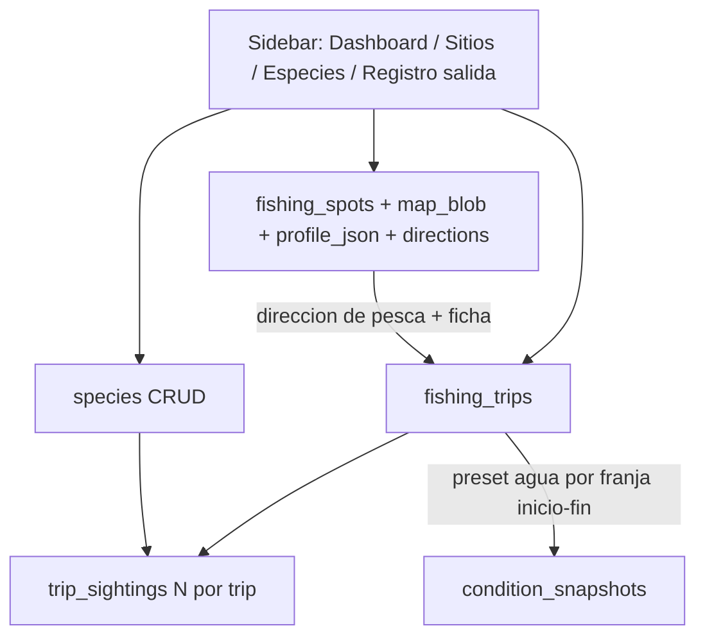

# Registro de salida al mar

Decisiones fijadas: mapas como **BLOB en SQLite**; análisis del spot con **prompt copiable + pegar respuesta** (sin API OpenAI).

## Arquitectura de datos



Sustituir el log plano actual (`fishing_logs` con un solo `species`/`pulpos_seen`) por un modelo de **salida (trip)** + **avistamientos (sightings)**. Los logs viejos se migran a trips mínimos (sin borrar historial).

## 1. Spots enriquecidos

Ampliar [`fishing_spots`](harpoonbook/db.py) y [`spots_admin.py`](harpoonbook/ui/spots_admin.py):

| Campo                               | Uso                                                                                                                        |
| ----------------------------------- | -------------------------------------------------------------------------------------------------------------------------- |
| `map_image_blob` + `map_image_mime` | Captura Google Maps/Earth subida a mano                                                                                    |
| `profile_json`                      | Ficha del spot (template fijo rellenado a mano / vía ChatGPT)                                                              |
| `approach_directions_json`          | Direcciones posibles de pesca en ese spot (N, S, NE…) con etiqueta corta y nota ("hacia el espigón", "hacia cala abierta") |
| `coast_facing`                      | Orientación aproximada de la costa (para leer corriente vs dirección de avance)                                            |

**Template de ficha** (`profile_json`), campos fijos:

- tipo de fondo (arena/roca/mixto + detalle)
- exposición (abierta / resguardada / mixto)
- profundidad típica (min–max m)
- puntos de referencia / peligros
- notas de corriente local
- resumen libre (texto pegado desde ChatGPT)

**Flujo al crear/editar spot:**

1. Subir imagen mapa → se guarda BLOB; se muestra en el panel.
2. Botón "Copiar prompt ChatGPT" con texto fijo que pide: tipo de fondo, exposición, orientación de costa, posibles direcciones de pesca, profundidad aparente, riesgos.
3. Textarea "Pegar respuesta" → botón "Aplicar a ficha" que rellena/actualiza `profile_json` (parseo ligero por secciones o todo en `resumen`; el usuario puede editar campos a mano después).
4. Editor de **direcciones de aproximación** (lista: brújula + etiqueta + notas).

En el **Dashboard**, al elegir un spot: mostrar miniatura del mapa + ficha resumida + direcciones disponibles.

## 2. CRUD de especies

Nueva tabla `species` y vista sidebar **Especies** ([`harpoonbook/ui/species_admin.py`](harpoonbook/ui/species_admin.py) nuevo):

- `id`, `label`, `category` (pez / crustáceo / cefalópodo / medusa / otro), `active`, `notes`
- Seed inicial desde `DEFAULT_SPECIES` actuales (pulpo, mero, etc.)
- Crear / editar / desactivar (mismo patrón que spots)

## 3. Vista nueva: Registro de salida

Nueva página sidebar **"Registro de salida"** ([`harpoonbook/ui/trip_log.py`](harpoonbook/ui/trip_log.py)). Quitar el formulario corto del final de [`app.py`](app.py); dejar en Dashboard solo un enlace / últimos trips resumidos.

### Bloques del formulario (rápido, con presets)

**A. Cabecera**

- Spot, método, score 0–10
- `started_at` / `ended_at` (datetime)
- **Dirección de pesca** (select de las definidas en el spot)
- Notas libres

**B. Agua (editable, con preset)**
Al cambiar spot + franja inicio/fin, cargar snapshot fusionado del día y rellenar:

- temperatura agua (Windy)
- visibilidad estimada (m) desde `forecast_visibility`
- corriente velocidad + dirección (Open-Meteo en la franja)
- turbidez (cualitativa: clara / media / turbia) — sin preset automático; default "media"

Todos editables. Guardar valores **efectivos** + opcionalmente los sugeridos (`*_suggested`) para calibrar después.

**C. Apneas (4 campos)**

- Cómo te has sentido (mal / regular / bien / muy bien)
- Promedio apnea (`mm:ss` o minutos + segundos)
- Profundidad promedio (m)
- ¿Ha costado compensar? (sí/no)

**D. Avistamientos (hasta N, p.ej. 8)**
Filas dinámicas (`st.data_editor` o "Añadir avistamiento"):

| Campo                    | Notas                                                    |
| ------------------------ | -------------------------------------------------------- |
| especie                  | select del CRUD                                          |
| vistas (nº)              |                                                          |
| veces vistas             | encuentros distintos                                     |
| intentaste pescar        | sí/no                                                    |
| si sí: unidades pescadas |                                                          |
| peso promedio (g/kg)     |                                                          |
| calidad del tiro         | n/a / perfecto_espina / justo_tripa / desgarro / fallido |

### Edición

Lista de trips recientes en la misma vista: elegir uno → formulario en modo edición → `update_trip` + reemplazo de sightings. Hoy no existe update; se añade en [`db.py`](harpoonbook/db.py).

## 4. Capas BD (esquema)

- `fishing_spots`: columnas nuevas (`map_image_blob`, `map_image_mime`, `profile_json`, `approach_directions_json`, `coast_facing`)
- `species` (nueva)
- `fishing_trips` (nueva): cabecera + agua + apneas + `features_snapshot_json` + `condition_snapshot_id`
- `trip_sightings` (nueva): FK a trip + especie + métricas
- Migración: cada fila de `fishing_logs` → un `fishing_trips` mínimo (método, score, notas, spot, `started_at=fishing_time`); `species`/`pulpos_seen` → un sighting si aplica. Mantener `fishing_logs` en solo lectura o dejar de usarla en UI.

## 5. Presets desde condiciones

Helper nuevo (p.ej. en [`harpoonbook/conditions.py`](harpoonbook/conditions.py) o `trip_presets.py`):

```
suggest_water_for_window(db, spot_id, started_at, ended_at)
  → {water_temp_c, visibility_m, current_speed_kmh, current_direction, snapshot_id, features}
```

Usa snapshot fusionado del día del `started_at` y la franja Windy/corriente más cercana al inicio (o media de la ventana).

## 6. Docs

Actualizar [`docs/datos-locales/spots-y-logs.md`](docs/datos-locales/spots-y-logs.md) y [`docs/README.md`](docs/README.md) con el nuevo modelo trip/sightings/species y el flujo del prompt ChatGPT.

## Fuera de alcance (esta iteración)

- Llamadas a OpenAI
- Calibración automática de visibilidad con logs
- Upwelling / Coriolis
- Fotos de capturas en el trip (solo mapa del spot)
