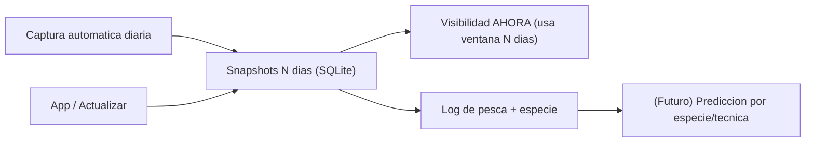

## Simplificar PoC Harpoonbook

### Principio rector

Todo lo que no acerque a (A) "decidir con los datos de los N dias" o (B) "acumular registros para predecir" se recorta. Fuentes finales sin login extra salvo la optica: Windy (viento/olas/swell), tablademareas (solunar+marea), Open-Meteo (corriente), Copernicus optics (claridad base).

### 1. Limpiar codigo muerto y duplicado

- Borrar [harpoonbook/recommender.py](harpoonbook/recommender.py): no se importa en `app.py`; es una version heuristica prematura del objetivo B que hoy solo estorba.
- Quitar corrientes Copernicus (duplican Open-Meteo, exigen login + NetCDF ~15 s/spot):
  - Borrar [harpoonbook/scrapers/copernicus_marine.py](harpoonbook/scrapers/copernicus_marine.py).
  - En [harpoonbook/features/build_features.py](harpoonbook/features/build_features.py) `get_currents_features` pasa a devolver solo `open_meteo`.
  - En [harpoonbook/merge_snapshots.py](harpoonbook/merge_snapshots.py) eliminar la rama `copernicus` del bucle de `merge_currents_hourly`.
  - En [app.py](app.py) la tabla "Corrientes modeladas" deja solo columnas OM (quitar CM y el mensaje `copernicusmarine login` para corrientes).
- Scripts auxiliares que ya no aportan: revisar/borrar [scripts/compare_currents_cabo_roig.py](scripts/compare_currents_cabo_roig.py) (depende de CM) y [scripts/probe_windy_currents.py](scripts/probe_windy_currents.py) (exploratorio).
- Opcional menor: `windy_embed.py` es solo un re-export de `windy.py`; importar `windy` directamente y borrar el alias.

### 2. Objetivo A - decidir con los datos de N dias

El nucleo del cambio. Hoy `forecast_visibility` solo mira el dia actual; hay que darle memoria.

- Captura automatica diaria (histórico que se acumule solo):
  - Anadir un entrypoint CLI (p.ej. `python -m harpoonbook.capture`) que llame a `capture_all_spots` en [harpoonbook/conditions.py](harpoonbook/conditions.py).
  - Documentar una Tarea Programada de Windows que lo ejecute 1-2 veces/dia (la maquina con `copernicusmarine login` para conservar la optica).
- Ventana de N dias en visibilidad ([harpoonbook/visibility.py](harpoonbook/visibility.py)):
  - Nueva funcion que lea los snapshots de los ultimos N dias (via `list_snapshots_for_day` por fecha) y calcule "energia reciente de mar de fondo" (max periodo/altura swell y oleaje de las ultimas 48-72 h).
  - Aplicar penalizacion de "agua aun asentandose": si hubo swell/oleaje fuerte los dias previos, la visibilidad de hoy baja aunque hoy este en calma (tal como explica el video de referencia).
  - Panel nuevo en `app.py`: "Contexto ultimos N dias" (swell/oleaje/corriente resumidos) para que la decision de hoy sea explicable.
- Tipo de fondo por spot (el video lo marca como factor clave y hoy no existe):
  - Anadir columna `bottom_type` (arena/roca/mixto) a `fishing_spots` en [harpoonbook/db.py](harpoonbook/db.py) (via `_ensure_column`) y editarlo en [harpoonbook/ui/spots_admin.py](harpoonbook/ui/spots_admin.py).
  - Usarlo como multiplicador en `visibility.py` (roca protege -> mejor; arena cerca -> mas turbidez).

### 3. Objetivo B - preparar datos (sin construir el modelo aun)

- Anadir campo `species` (especie objetivo) al log en [harpoonbook/db.py](harpoonbook/db.py) (`fishing_logs`) y al formulario de [app.py](app.py). El `method_id` ya cubre la tecnica.
- Confirmar que cada log guarda fase lunar y estacion (derivables de `solunar` + fecha ya presentes en el snapshot) para que el futuro modelo tenga etiquetas + features. No se implementa ML ahora.

### 4. Documentacion

- Actualizar [docs/README.md](docs/README.md) y borrar [docs/fuentes/copernicus-corrientes.md](docs/fuentes/copernicus-corrientes.md).
- Actualizar [docs/logica/prevision-visibilidad.md](docs/logica/prevision-visibilidad.md) con la ventana de N dias y el tipo de fondo.
- Ajustar [README.md](README.md) (Copernicus solo para claridad del agua, no corrientes).

### Notas / limitaciones asumidas

- Con captura automatica el histórico es util a partir de ~N dias de rodaje (arranque en frio). Si mas adelante quieres verlo util "ya", se puede anadir un backfill puntual desde el archivo de Open-Meteo (fuera de este alcance por tu eleccion).
- Upwelling/downwelling (viento paralelo a costa + Coriolis) queda anotado como mejora futura: requiere orientacion de costa por spot.
